## Контекст

Союз экспортёров и производителей зерна ежегодно проводит отраслевой форум. Участники подают заявки, компании привозят делегатов, а оргкомитет всё это обрабатывает. Подтверждает регистрации, выставляет счета, следит за оплатами и собирает списки к аккредитации.

До нас это работало на двух несвязанных системах. Снаружи стоял сайт со сломанной структурой, через который подавали заявки. Внутри был Битрикс, куда заявки попадали и где их обрабатывали. Под задачи форума он не подходил, поэтому данные переносили между разделами руками, статусы дублировали, а списки участников сверяли в Excel.

Нужно было собрать одну систему на общих данных, с публичной частью для участников и внутренней для оргкомитета.

## Сегменты аудитории

**Снаружи**
- **Участники форума**
  компании и частные лица, подают заявки
- **Представители компаний**
  регистрируют делегатов, платят за участие, ведут документы

**Внутри**
- **Администраторы форума**
  обрабатывают заявки, контролируют оплаты и регистрацию
- **Руководство**
  смотрит показатели по форуму

## Пользовательские проблемы

**Снаружи**
- **На сайте нельзя было сориентироваться.**
  Информация о форуме и кнопка регистрации терялись в навигации.
- **Регистрация была непрозрачной.**
  Подав заявку, участник не понимал, на каком она этапе.
- **Личного кабинета не существовало.**
  Компания не могла сама вести делегатов, менять данные или смотреть счета, все шло через менеджера.

**Внутри**
- **Заявки обрабатывали руками.**
  Данные переносили между разделами, статусы дублировали, списки сверяли в таблицах.
- **Не было общей картины.**
  Чтобы понять, как идут регистрации и оплаты, приходилось собирать цифры по разделам.
- **Отчётность собирали вручную.**
  Каждый отчёт руководству это отдельная работа с выгрузками.

## Задача

Заменить сайт и Битрикс одной системой. Публичная часть, где участник регистрируется и ведёт участие сам, и CRM, где оргкомитет работает с теми же данными без ручного переноса.

## Процесс

1. Заказная разработка, но здесь был прямой контакт с заказчиком. Его представители оказались и целевыми пользователями. На встречах они показывали свою работу в старой системе, куда нажимают и где болит. Проблемы в кейсе взяты оттуда, а не из моих предположений.
2. Задачи приносил аналитик, иногда архитектор. На показы ходила сама, замечания обсуждали на месте.
3. Визуальную часть собирала с нуля. От союза был только логотип, весь стиль и концепт делала я. Контент и фотоматериалы для сайта тоже предлагала сама.
4. Дизайн-систему собрала в своём ките в Figma, общем для сайта и CRM, чтобы обе части выглядели одним продуктом.

## Решения

### Сайт: структура и регистрация

Переработала сайт целиком, от навигации до визуала. Главная собрана вокруг ближайшего события, ключевая информация и кнопка регистрации видны сразу, искать по разделам не нужно.

Регистрация собрана в одну форму с переключателем типа участника. Физлицо, ИП или юрлицо, поля меняются под выбранный тип, лишнее не показывается. По ходу заполнения работают подсказки и проверка данных. Готовая заявка уходит в CRM автоматически.

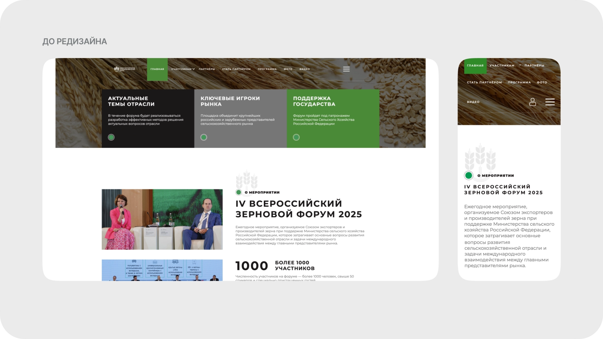
*До редизайна: информация о форуме и регистрация терялись в навигации*

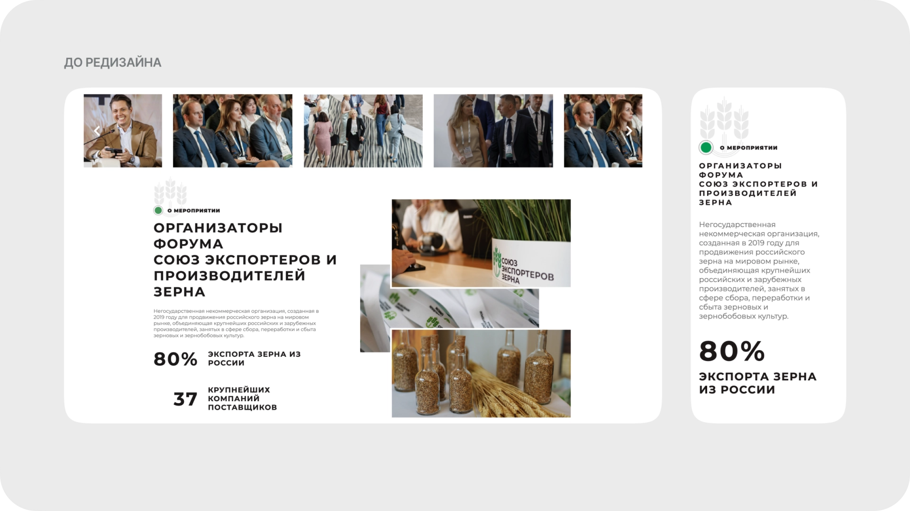

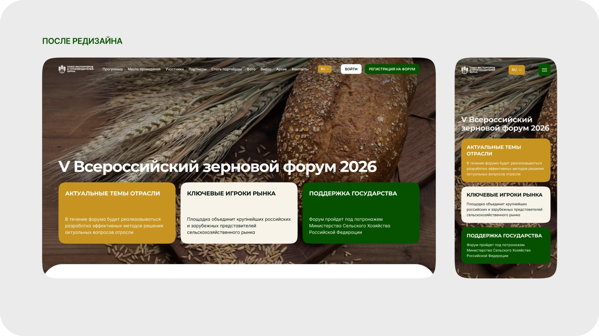
*После: главная собрана вокруг ближайшего события, регистрация видна сразу*

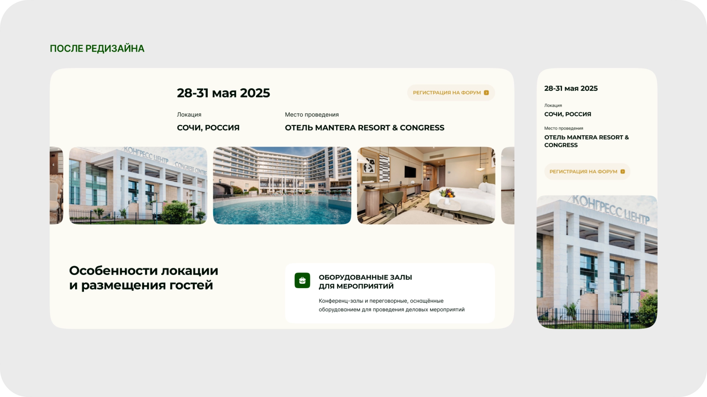

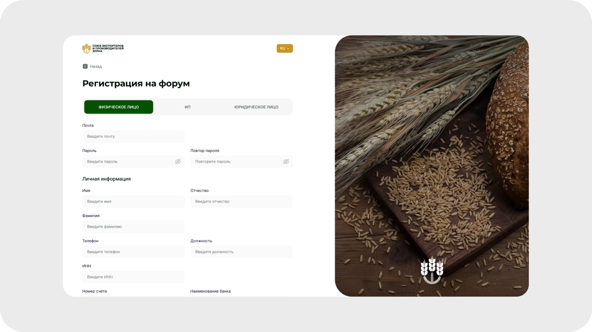
*Поля меняются под выбранный тип участника, лишнее не показывается*

### Личный кабинет

Представитель компании ведёт участие сам. Добавляет делегатов, правит их данные, удаляет, подаёт заявки. Система подставляет то, что уже знает о компании, заполнять всё заново не нужно.

Статусы заявок и оплат видны прямо в кабинете. Данные синхронизируются с CRM, поэтому администратору не приходится ничего переносить, а участнику писать менеджеру, чтобы узнать, что происходит.

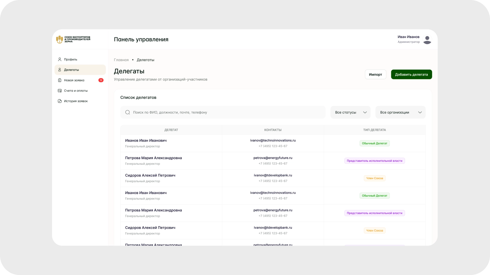

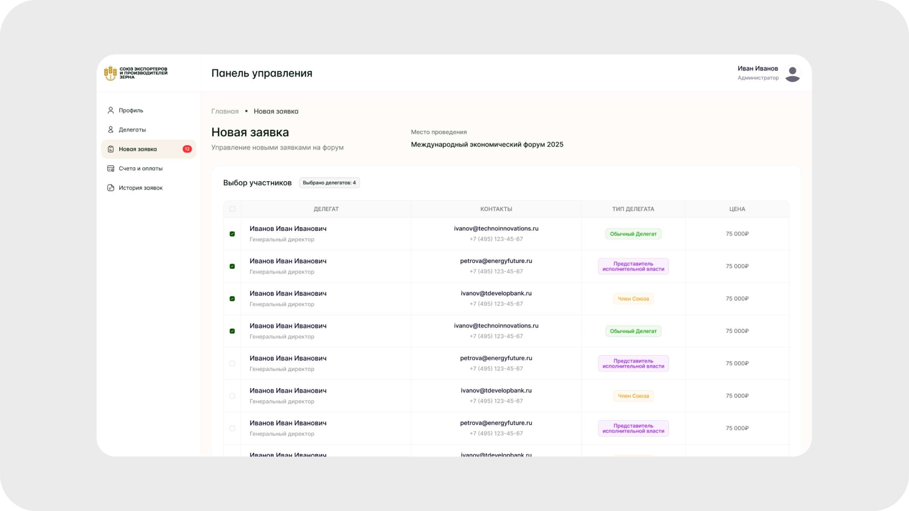
*Данные компании подставляются, заполнять заново не нужно*

### Работа с заявками в CRM

Заявки собраны в таблицы с фильтрами и поиском, отдельно по основному событию и гала-ужину. Рядом справочник участников и раздел делегатов, связанный с аккредитацией, печатью бейджей и подсчётом по мероприятиям.

Статусы оплаты разложены по явным этапам, от ожидания счёта до полной оплаты, с отдельными состояниями для частичной оплаты и просрочки. Администратор видит положение дел, не выясняя его вручную.

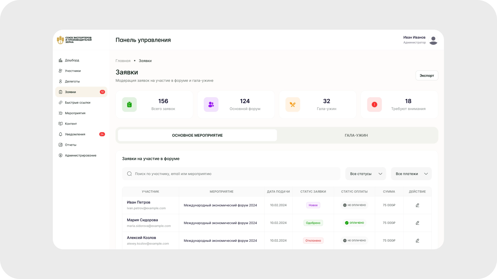

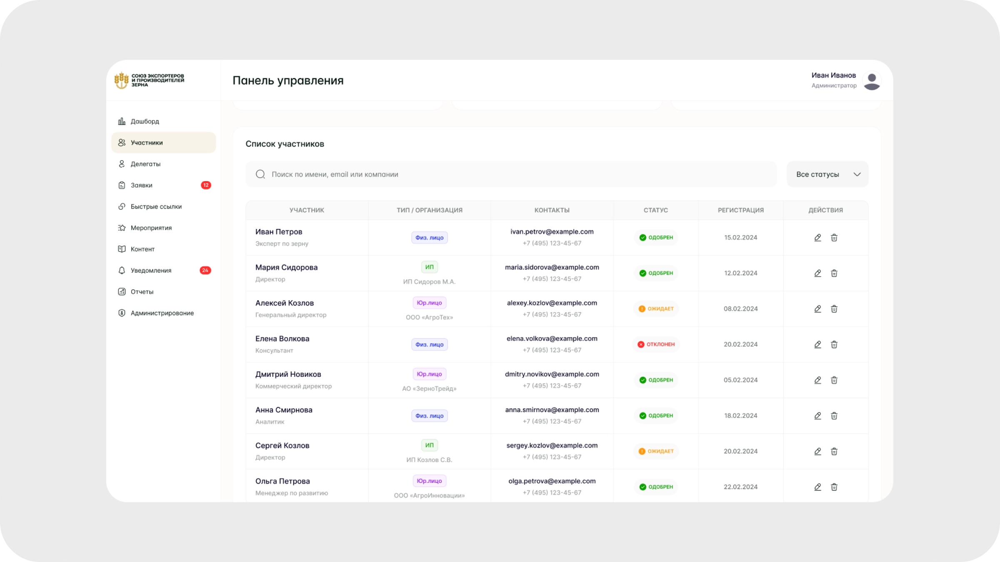

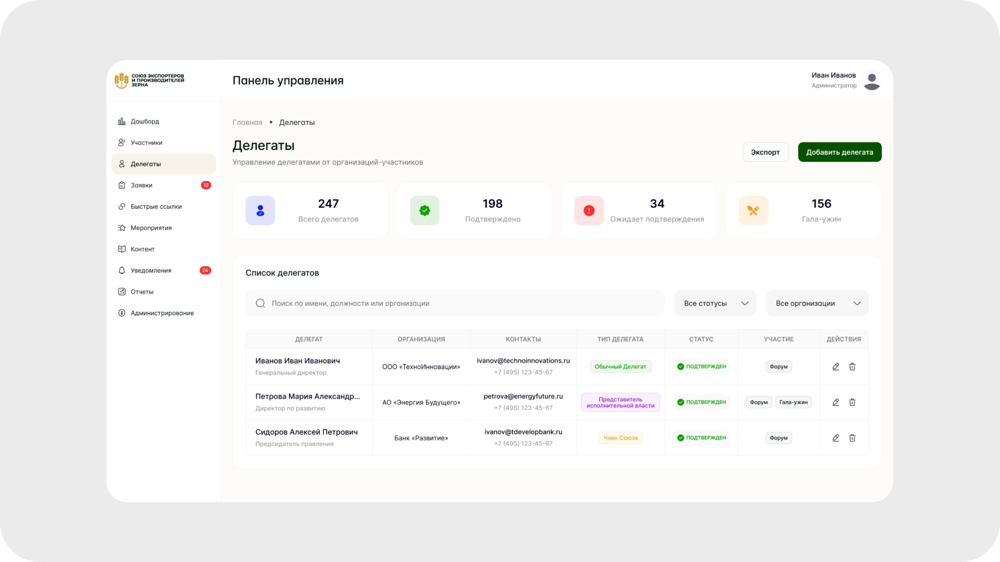

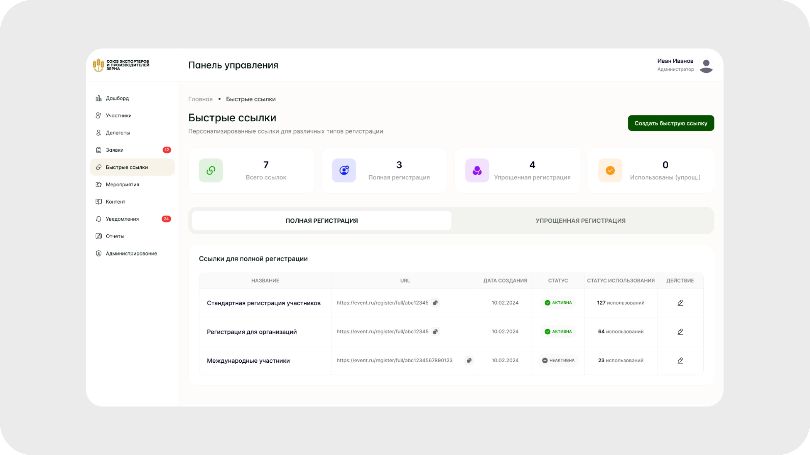
*Ссылка под каждый тип регистрации, по каждой видно число использований*

### Контроль и аналитика

Дашборд собирает ключевые цифры форума. Сколько подано заявок, сколько регистраций оплачено, кто идёт на гала-ужин, где оплата просрочена. График регистраций по дням показывает динамику и помогает планировать нагрузку. Блок уведомлений выводит новые заявки и изменения статусов, чтобы не искать их по разделам.

В разделе отчётов выгрузку можно собрать без разработчиков. Пользователь выбирает источник данных, настраивает фильтры и поля, сохраняет шаблон и выгружает в Excel, PDF или CSV.

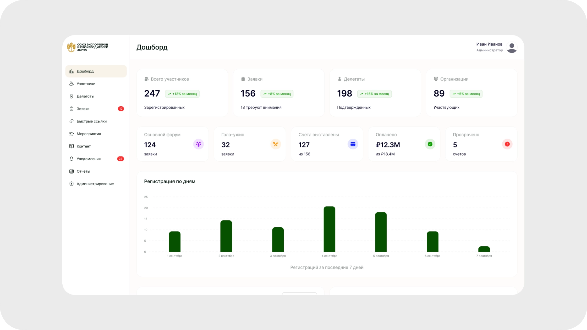

## Результат

Сайт и CRM собраны и сданы в разработку, система готовилась к запуску на ближайшем форуме. Вместо двух несвязанных систем оргкомитет получил одну, где заявка с сайта сразу попадает в работу, а участник видит свои статусы без звонка менеджеру. Запуск я уже не застала, метрик нет.

## Рефлексия

Это был единственный проект, где я разговаривала с пользователями напрямую. Представители заказчика садились показывать свою работу в старой системе, и половина проблем всплывала на этих встречах сама, выводить их из документации не пришлось.

Разница с проектами, где связь с пользователем идёт через посредника, оказалась в скорости. Вопрос, на который иначе уходит круг согласований, закрывается на встрече за минуту. И решения перестают быть догадками. Когда человек при тебе ищет кнопку и не находит, обосновывать перестановку уже не нужно.
