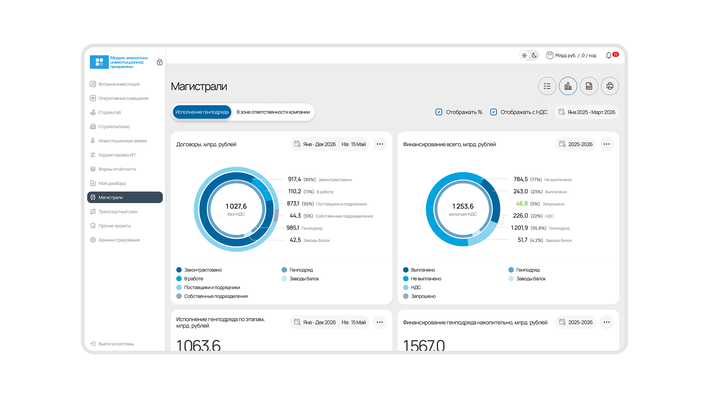
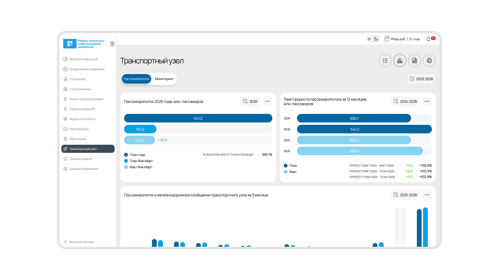
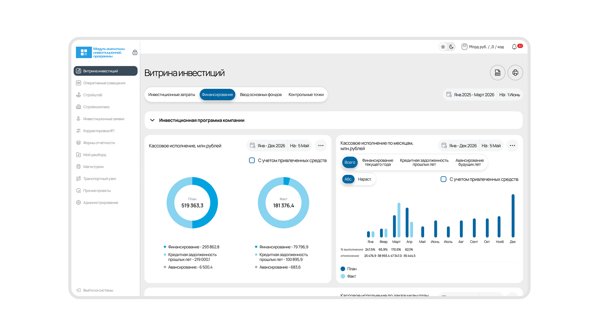
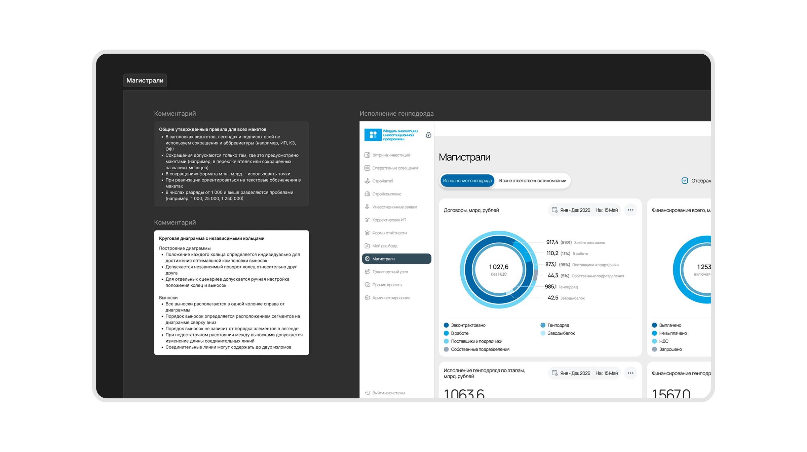
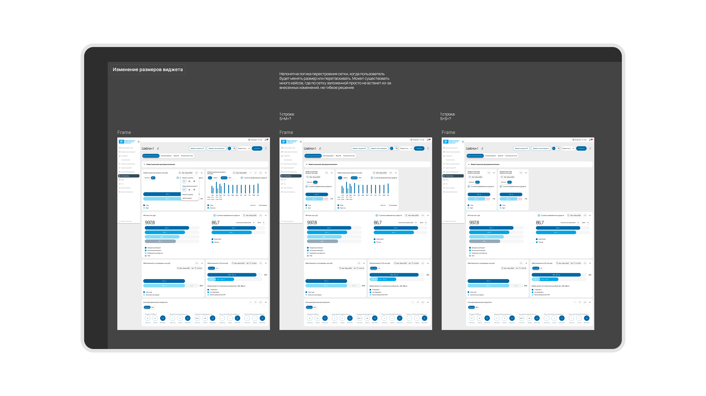

## Контекст

Система следит за тем, как идёт инвестиционная программа компании. Показывает, сколько запланировано и сколько законтрактовано, что уже выплачено и где проекты отстают от графика. Данные приходят из смежных систем, интерфейс выводит их дашбордами и витринами.

Смотрят это руководители на оперативных совещаниях. В большинстве модулей набор виджетов фиксированный, пользователь только фильтрует данные по периодам и разрезам. Отдельно есть мой дашборд, где человек сам выбирает, какие виджеты держать перед глазами.

Система развивалась с 2023 года очередями. Я пришла в 2026-м, когда часть модулей уже работала.

## Задача

Спроектировать новые модули аналитики. Собрать их пришлось внутри системы, которую пересобрать было нельзя, и при этом не дать ей разъехаться ещё сильнее.

## Процесс

1. Задачи на модули приносили аналитики, решения по интерфейсу оставались за мной.
2. Подготовка к показу. Подставляли реальные данные, я собирала кликабельный прототип, чтобы на встрече было видно, что откуда берётся.
3. Ходила на показы лично, вместе с лидом и руководителем проекта.
4. Поверх модулей шёл отдельный слой работы. Мы закрывали договор, и часть доработок нужна была прежде всего для формального закрытия пунктов. Своих модулей это не касалось, но объём был заметный.

## Решения

### Новые модули

Собрала витрину инвестиций, оперативные совещания, строительный комплекс и два отраслевых направления. Каждый устроен как сводный дашборд с кольцевыми диаграммами, графиками план-факт-прогноз, таблицами отклонений и фильтрами по периодам.

Все новые модули стоят на компонентах и унифицированы между собой. До этого макеты в системе собирали копированием.

Отдельно, уже своей инициативой, проработала то, чего в системе не было совсем. Корнер-кейсы и состояния вроде поведения графика по наведению. Раньше существовали только статичные макеты.

### Правила вместо пересборки

Компонентов в системе не было, а пересобрать её было нельзя. Работа шла по договору, пересборка означала новый договор, обосновать это заказчику посреди незакрытого этапа не получалось, пришлось бы объяснять, что сделанное раньше устарело и надо переделывать.

Что удалось в этих рамках. Повторяющиеся элементы вроде сайдбара и хэдера свела к одному компоненту и разнесла по модулям. Выровняла и стабилизировала размеры, чтобы новые модули опирались на общую логику. Остальное зафиксировала правилами. Как строятся кольцевые диаграммы и где располагаются выноски, как разделяются разряды в числах, где допустимы сокращения, а где нет. Правилами пользовалась не только я, их читала разработка.

Унификация вышла неполной. В новых модулях появились типы кольцевых диаграмм, которых в системе раньше не было, и свести их к существующим не получилось. Они стали отдельной сущностью со своими правилами.

### Где система упёрлась в саму себя

Часть работы не удалось довести до конца, и в обоих случаях причина была одна.

**Кольцевые диаграммы.** В системе была устоявшаяся круговая, значения выводились в легенде и в тултипе по наведению. На показах заказчик захотел выноски, подписи на линиях, выстроенные ровным столбцом справа.

Так диаграммы в интерфейсах не работают. Чтобы выноски встали в столбец, кольцо нужно разворачивать вручную под каждый набор данных. Обсудила с лидом и руководителем проекта, договорились показы провести как есть, а перед передачей в разработку собрать жизнеспособный компонент.

Когда это время пришло, я пересобрала виджеты и прописала правила. Заказчик потребовал вернуть как было, и мы откатили макеты. Менять даже угол поворота кольца он отказался.

Тогда я оставила рядом с макетами описание ограничений и альтернативу. Положение сегментов в текущем решении не определяется едиными правилами и может отличаться от виджета к виджету. При изменении состава данных кольца и выноски придётся настраивать руками. На новых сценариях поведение диаграммы становится непредсказуемым.

Альтернатива была в фиксированном стартовом угле для каждого кольца. Компоновка остаётся стабильной при изменении данных, ручная подгонка не нужна, выноски для всех круговых диаграмм можно строить одним алгоритмом, и компонент становится проще в сопровождении.

Решение не приняли, но оно зафиксировано.

*Ограничения решения и альтернативу описала рядом с макетами*

**Масштабирование виджетов.** Была задача на смену размера виджета и ручную настройку сетки в моём дашборде. Чтобы её сделать, нужно проработать несколько размеров, а для этого разобрать каждый виджет и понять, какие элементы внутри него действительно нужны, а какие остались от прошлых решений.

Разобрать это можно было только пройдя всю логику системы заново. Плюс сама сетка не держалась. Как она перестраивается при смене размера или перетаскивании, не описывал ни один сценарий, и слишком много случаев, где виджет просто не встаёт на место. Задача упиралась в пересборку, поэтому её приостановили.

*Логика перестроения сетки не описывалась ни в одном сценарии, слишком много случаев, где виджет не встаёт на место*

## Результат

Новые модули собраны и стоят на стенде, прошла серия показов. К моменту моего ухода команда готовилась выделять ресурсы на полную пересборку системы.

## Рефлексия

Когда приходишь на такой проект, первое желание переделать всё начисто. Система выглядит так, будто в таком виде существовать не может, а она существует и должна развиваться дальше.

Пересборка почти никогда не вариант. Она упирается в договор и в то, что кому-то придётся объяснять, почему сделанное раньше нужно выбросить. Значит остаётся балансировать. Что-то поменять, где-то договориться, остальное удержать правилами вместо компонентов.

И держать в голове, что рано или поздно придёт задача, которая упрётся в полную пересборку. Тогда важно суметь это назвать и вовремя остановиться.
